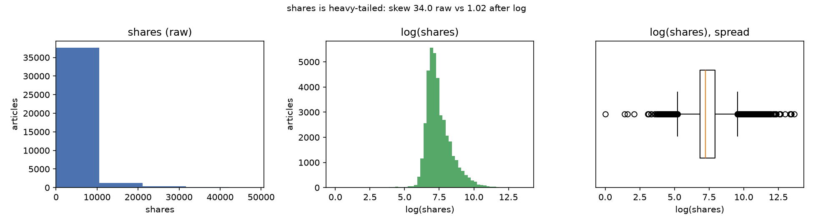
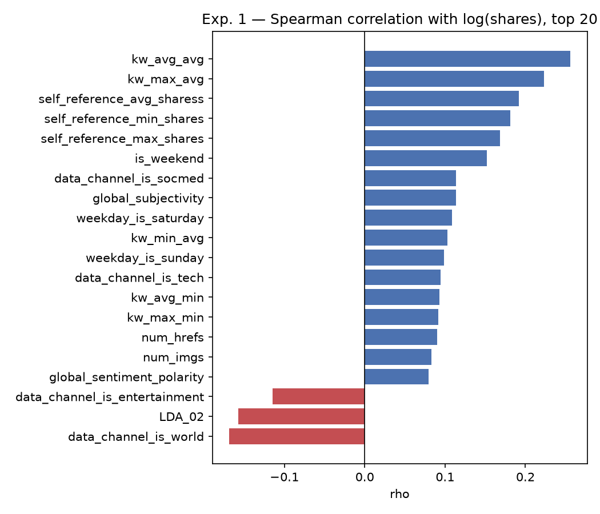
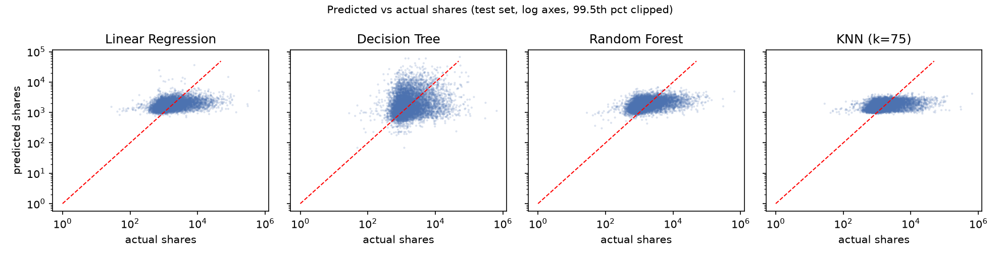
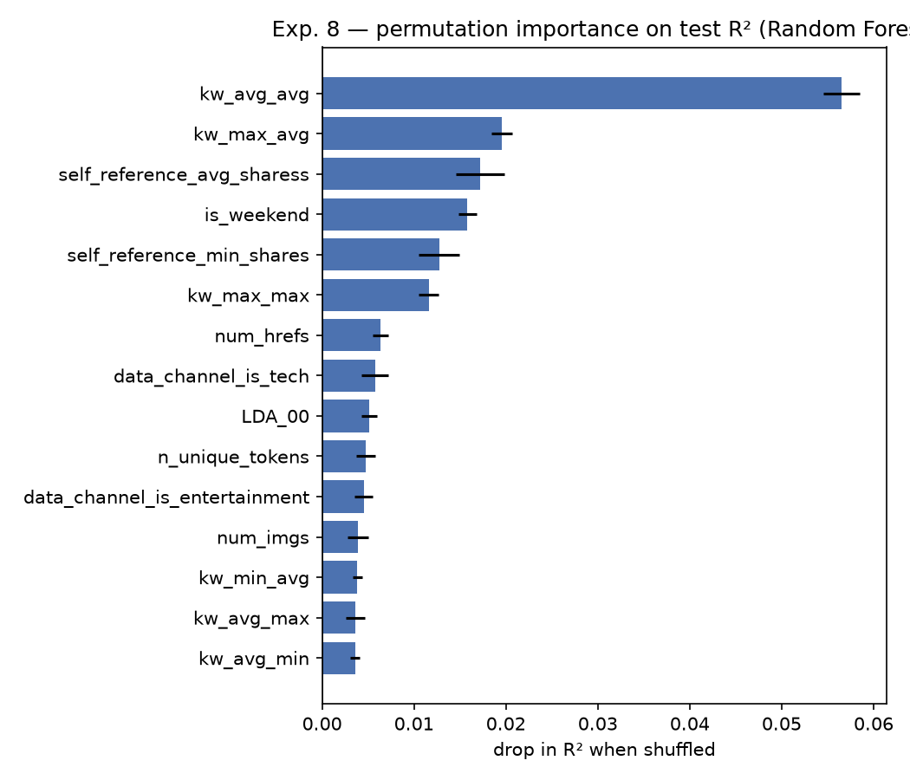
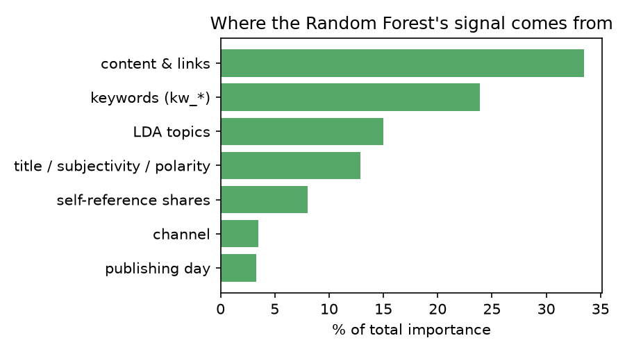

# P11 — Online News Popularity: predicting article sharing before publication

**Course:** Introduction to Machine Learning — project lab · **Group:** G11 · **Dataset:** UCI *Online News Popularity* (Mashable)

| Deliverable | Location |
|---|---|
| Notebook | `notebooks/P11_online_news_popularity.ipynb` |
| Code library | `src/` (`data`, `preprocess`, `eda`, `regression`, `classification`, `interpret`, `run_all`) |
| Results (tables, figures) | `reports/results/`, `reports/figures/` |
| Live demo | `demo/predict_demo.py` |
| Repository | `https://github.com/Akshitsingh070/online-news-popularity-iml` — layout and run instructions in `README.md` |

---

## 1. Problem statement

Mashable published several thousand articles per year and shared them through its own site and
social channels. Each article was tagged with a **share count** — the number of times it was
distributed through social networks — and that number varies over four orders of magnitude, from a
single share to almost a million.

**Question.** Given only properties of an article that are known *at the moment it is written* —
its text statistics, its links and media, the popularity history of its keywords, its topic and its
publishing day — can we predict how widely it will be shared?

Two formulations are studied, because they answer two different business questions:

* **Regression.** Predict `shares` as a number. This is what an editor wants ("how many shares
  will this get?") and the formulation in which the task is hardest, because squared error is
  dominated by rare viral hits.
* **Classification.** Predict a binary label `popular = shares ≥ median(training shares)`. This is
  what a content-planning tool actually needs ("should this be scheduled in a prominent slot?") and
  it is a fairer test of whether the features carry signal at all.

The deliverables are the executed notebook, this 6–8 page report, the repository and a 10-minute
presentation with a live demo.

---

## 2. Data

### 2.1 What we loaded, and the row-count discrepancy

The UCI dataset page advertises **39 797 instances**. The CSV inside the distributed archive
(`OnlineNewsPopularity.zip`) does **not** contain that many rows: we load **39 644 rows × 61
columns** — **153 rows fewer** than the page states. The count is verified at load time
(`src/data.py::row_count_report`, exported to `reports/results/00_row_count.csv`) and the loaded
number, not the advertised one, is used throughout.

Structure of the 61 columns:

| block | columns | examples |
|---|---|---|
| identifier | 1 | `url` — unique per article, dropped |
| timestamp | 1 | `timedelta` — days since first article, dropped |
| text statistics | 12 | `n_tokens_title`, `n_tokens_content`, `n_unique_tokens`, `average_token_length`, … |
| links & media | 4 | `num_hrefs`, `num_self_hrefs`, `num_imgs`, `num_videos` |
| keyword quality | 10 | `kw_avg_avg`, `kw_max_avg`, `kw_min_min`, … |
| keyword history | 3 | `self_reference_min/max/avg_sharess` |
| LDA topics | 5 | `LDA_00 … LDA_04` |
| sentiment | 7 | `global_subjectivity`, `global_sentiment_polarity`, `abs_title_*` |
| publishing day | 7 | `weekday_is_monday … weekday_is_sunday`, `is_weekend` |
| channel | 6 | `data_channel_is_lifestyle … data_channel_is_world` |
| **target** | 1 | `shares` |

Integrity checks (all in `reports/results/01_sanity.csv`): **0 duplicate rows, 0 missing values**.
1 181 articles (3.0 %) have `n_tokens_content == 0` — link-only or gallery posts, for which the
derived ratio features (`n_unique_tokens`, `n_non_stop_words`) are degenerate. We keep these rows
rather than discarding 3 % of the corpus, and flag the consequence in §6.5. No article has
`shares == 0`, so `log(shares)` needs no offset.

### 2.2 The target: extreme skew

| statistic | `shares` |
|---|---|
| minimum | 1 |
| median (p50) | 1 400 |
| mean | 3 395 |
| p90 / p95 / p99 | 6 200 / 10 800 / 31 657 |
| maximum | 843 300 |
| skewness | **33.96** |
| kurtosis | 1 832.7 |
| mean / median | 2.43 |
| share of all shares held by the top 1 % of articles | **21.8 %** |



*Figure 1 — raw shares (left, clipped at the 99.5th percentile) versus `log(shares)` (middle) and
the log-scale spread (right). Log-skewness drops from 33.96 to 1.02.*

---

## 3. Method

### 3.1 Protocol

* One **80 / 20 hold-out split** (`random_state = 42`): 31 715 training rows, 7 929 test rows,
  58 features.
* All preprocessing that learns from data (`StandardScaler`) is fitted on **training rows only**.
* The classification threshold is the **training median = 1 400 shares**, applied unchanged to the
  test rows. This keeps the test labels independent of the test distribution (popular rate: 0.536
  train / 0.524 test).
* Hyper-parameters are **fixed, not tuned against the test set**, because the experiment compares
  model *families*. The single exception is KNN's `k`, chosen on a 15 % validation slice carved out
  of the training data (k = 75 beat 35, 15 and 5: validation MAE on `log(shares)` 0.6364 vs
  0.6394 / 0.6472 / 0.6921).

### 3.2 Dropped columns

| column | reason |
|---|---|
| `url` | Unique per article. It cannot generalise to an unpublished article; a tree could memorise individual rows. |
| `timedelta` | Days since the first article — a publication timestamp. A truthful *before-publication* prediction does not know the date, and keeping it would let the model memorise specific weeks of a fixed two-year window. |

58 features remain, matching the dataset documentation.

### 3.3 Why `log(shares)` (Exp. 2)

`shares` is heavy-tailed, so a squared-error model on the raw scale is dominated by a handful of
viral articles: the loss is minimised by predicting a conditional **mean** that few articles
actually have. Modelling `log(shares)` compresses four orders of magnitude into a roughly symmetric
target (skew 1.02), stabilises the variance and turns multiplicative effects into additive ones.

The claim is measured, not asserted — same model, same split, both scored back on the share scale
(`reports/results/exp2_log_vs_raw_target.csv`):

| target | MAE (shares) | median abs. error (shares) | R² (share scale) | R² (log scale) |
|---|---|---|---|---|
| raw `shares` | 2 998.7 | 1 682.3 | **+0.0262** | −0.3898 |
| `log(shares)` | **2 347.8** | **733.1** | −0.0029 | **+0.1274** |

The raw-target model "wins" on share-scale R² only because one 843 300-share article inflates the
variance it is accidentally close to; for the **typical** article it is off by 1 682 shares versus
733 for the log model — a 2.3× difference that no editor would ignore. We therefore model the log
and **always report metrics after mapping predictions back** with `expm1`, clipped at 1 share. This
is deliberate: the badly-behaved tail still shows up in R², so the log transform does not hide the
model's failure on virality.

### 3.4 Models and settings

| family | regression | classification |
|---|---|---|
| Linear | `LinearRegression` on standardised features | `LogisticRegression(max_iter=2000, C=1)` on standardised features |
| Decision Tree | `min_samples_leaf=5` | `max_depth=8, min_samples_leaf=20` |
| Random Forest | 300 trees, `min_samples_leaf=2`, `max_features=0.5` | same |
| KNN | `k=75`, distance weights, standardised | same |
| SVM | — | `SVC(kernel="rbf", C=1, gamma="scale")`, full 31 715-row training set (131 s) |

Tree depth / leaf sizes were chosen as conservative defaults to avoid memorising 31 715 rows of
noise; the comparison in §4 is therefore between families at comparable regularisation strength, not
between individually tuned models.

### 3.5 Metrics

* **MAE (shares)** — average absolute error in shares, on the original scale.
* **R² (share scale)** — coefficient of determination on the original scale; the primary regression
  metric, and the one the brief asks for.
* **R² (log scale)** — reported alongside because it is the scale the models were fitted on.
* **F1 (popular)** — harmonic mean of precision and recall for the positive ("popular") class;
  ROC-AUC added as a threshold-free companion.
* **Baseline** — "always predict the training median (1 400 shares)". Any regressor that cannot beat
  it on MAE is useless in practice.

---

## 4. Results

### 4.1 Exp. 1 — EDA: which features relate to `log(shares)`?

Spearman correlation with `log(shares)` (`reports/results/exp1_correlations.csv`):

| feature | Spearman ρ | Pearson r | what it measures |
|---|---|---|---|
| `kw_avg_avg` | **+0.256** | +0.222 | average share count of the article's keywords |
| `kw_max_avg` | +0.223 | +0.109 | best-performing keyword |
| `self_reference_avg_sharess` | +0.192 | +0.087 | average shares of articles this one links to |
| `self_reference_min_shares` | +0.182 | +0.073 | weakest self-referenced article |
| `self_reference_max_shares` | +0.169 | +0.077 | strongest self-referenced article |
| `data_channel_is_world` | −0.168 | −0.152 | world-news channel |
| `LDA_02` | −0.157 | −0.165 | one specific topic mixture |
| `is_weekend` | +0.152 | +0.114 | published on a weekend |


*Figure 2 — Spearman correlation with `log(shares)`, top 20 features.*

Medians by channel (`reports/results/exp1_channels.csv`): social media 2 100 shares (n = 2 323),
no channel 1 900 (6 134), lifestyle 1 700 (2 099), tech 1 700 (7 346), business 1 400 (6 258),
entertainment 1 200 (7 057), world 1 100 (8 427). A ~2× spread in medians — real, but modest.

**Reading.** Every strong correlate is a *history* variable: how similar content performed before.
No purely textual property (length, sentiment, readability) reaches ρ = 0.1. The strongest single
signal in the entire corpus is therefore not a property of the article at all, but a property of
Mashable's past audience behaviour — a warning we return to in §5.

### 4.2 Exp. 3–7 — Regression (target `log(shares)`, metrics on the share scale)

| model | MAE (shares) | RMSE | **R² (share scale)** | R² (log scale) | median abs. error | fit |
|---|---|---|---|---|---|---|
| Baseline: training median | 2 395.4 | 11 152.9 | −0.0308 | −0.0578 | 600.0 | — |
| Linear Regression | 2 347.8 | 11 000.9 | −0.0029 | 0.1274 | 733.1 | 0.1 s |
| Decision Tree | 3 019.3 | 11 340.3 | −0.0657 | −0.3903 | 975.1 | 2.0 s |
| **Random Forest** | **2 316.5** | **10 967.0** | **0.0033** | **0.1697** | 745.8 | 18.1 s |
| KNN Regressor (k=75) | 2 334.9 | 11 034.9 | −0.0091 | 0.1077 | **703.8** | 0.3 s |


*Figure 3 — predicted vs actual shares (log axes) for the four regressors. Predictions form a narrow
vertical band; articles above ~50 000 shares are systematically under-predicted.*

**Honest reading.**

* The **Random Forest is the best** model on MAE and on both R² definitions, but its share-scale
  R² of **0.003** means it explains essentially none of the raw variance. It beats the constant
  baseline by 79 shares of MAE (3 %), which is a real but small gain.
* The **Decision Tree is worse than the baseline** (R² −0.07): a single tree partitions 31 715 noisy
  rows into boxes whose means are unstable, the textbook variance problem that bagging fixes.
* **KNN** has the lowest *median* absolute error (704 vs 746 shares) — it is decent on typical
  articles and hopeless on the tail, because averaging 75 neighbours always lands near the middle.
* Two of five models have **negative** R² on the raw scale: predicting the mean is genuinely better
  in squared-error terms than trying to chase variance that the features do not contain.

**Ranking still works (Figure 4 / `exp3_quintile_calibration.csv`).** Sorting the 7 929 test
articles by the Random Forest's prediction and splitting into quintiles:

| predicted quintile | predicted median | actual median | actual mean |
|---|---|---|---|
| Q1 (lowest) | 1 105 | 957 | 1 535 |
| Q2 | 1 453 | 1 200 | 2 292 |
| Q3 | 1 769 | 1 400 | 2 692 |
| Q4 | 2 197 | 1 900 | 3 762 |
| Q5 (highest) | 2 987 | **2 700** | 6 355 |

Actual medians climb monotonically, a **2.8× lift from Q1 to Q5**. The model cannot say *how many*
shares an article will get, but it can say which of two articles is more likely to travel — that is
the realistic deliverable.

### 4.3 Exp. 4–8 — Classification (popular = shares ≥ 1 400, training median)

| model | accuracy | precision | recall | **F1 (popular)** | ROC-AUC | fit |
|---|---|---|---|---|---|---|
| **Random Forest** | **0.6664** | 0.6649 | 0.7326 | **0.6971** | **0.7264** | 18.3 s |
| SVM (RBF) | 0.6559 | 0.6588 | 0.7124 | 0.6846 | 0.7142 | 131.0 s |
| Logistic Regression | 0.6523 | 0.6581 | 0.7004 | 0.6786 | 0.7053 | 0.3 s |
| Decision Tree | 0.6399 | 0.6457 | 0.6934 | 0.6687 | 0.6875 | 1.3 s |
| KNN (k=75) | 0.6407 | 0.6571 | 0.6573 | 0.6572 | 0.6902 | 0.6 s |

Random Forest confusion matrix on the test set:

|  | predicted: not popular | predicted: popular |
|---|---|---|
| **actual: not popular** | 2 240 | 1 534 |
| **actual: popular** | 1 111 | 3 044 |

**Reading.** All five families land inside a narrow F1 band of 0.657–0.697 and an AUC band of
0.687–0.726: the choice of algorithm moves the result by ~0.04, far less than the choice of target
does. Recall (0.73) exceeds precision (0.66) because the model leans towards "popular" — a
reasonable bias for a scheduling tool, where a missed hit costs more than a wasted slot. The SVM
costs 400× the training time of Logistic Regression for +0.006 F1; on this dataset it is not worth
it.

Both numbers must be read with the split in mind: classification is *easier* than regression here
because the median split discards the impossible tail and asks only "above or below 1 400"; and
"popular" is not "viral" — a 100 000-share article and a 1 500-share article are identical to this
classifier.

### 4.4 Exp. 8 — Which features matter?

Permutation importance on the test set (drop in R² when a column is shuffled), Random Forest
regressor, 5 repeats (`exp8_permutation_importance.csv`):

| feature | Δ R² (mean ± sd) |
|---|---|
| `kw_avg_avg` | **0.0565 ± 0.0020** |
| `kw_max_avg` | 0.0196 ± 0.0011 |
| `self_reference_avg_sharess` | 0.0172 ± 0.0027 |
| `is_weekend` | 0.0158 ± 0.0010 |
| `self_reference_min_shares` | 0.0127 ± 0.0022 |
| `kw_max_max` | 0.0116 ± 0.0011 |
| `num_hrefs` | 0.0064 ± 0.0008 |
| `data_channel_is_tech` | 0.0057 ± 0.0015 |
| `LDA_00` | 0.0052 ± 0.0008 |
| everything else | < 0.005 |


*Figure 4 — permutation importance on test R² (Random Forest regressor).*


*Figure 5 — share of total importance by feature group (Random Forest classifier).*

| feature group | share of importance |
|---|---|
| content & links (length, media, hrefs, readability) | 33.5 % |
| keywords (`kw_*`) | 23.9 % |
| LDA topics | 15.0 % |
| title / subjectivity / polarity | 12.9 % |
| self-reference shares | 8.0 % |
| channel | 3.5 % |
| publishing day | 3.3 % |

**One third of the model's signal (31.9 %) is Mashable's own historical performance**, i.e. the
`kw_*` and `self_reference_*` blocks; content, links, topics and timing share the remaining 68.1 %.
`kw_avg_avg` alone is worth more test R² than any other ten features combined. Among genuinely
textual properties, the model prefers *how many outbound links* an article has over its length,
sentiment or readability.

The standardised logistic coefficients tell a cautionary tale: the two largest terms are
`n_non_stop_words` (+1.52) and `n_non_stop_unique_tokens` (−1.01), which are **artefacts** of the
1 181 empty articles (both ratios are degenerate for zero-token rows). The first interpretable term
is `kw_avg_avg` (+0.94). Impurity-based importances agree with the permutation ranking at the top
(`kw_avg_avg` 0.077, `kw_max_avg` 0.050) but inflate continuous, high-cardinality features lower
down, which is why we prefer the permutation view.

---

## 5. Interpretation: what an article's features cannot capture

**A low R² here is not a bug — it is the finding.** The features describe the article; virality is
a property of the *audience and the environment* the article lands in. Concretely, nothing in the
58 columns measures any of the following, and each of them can move shares by an order of magnitude:

1. **Distribution and placement.** Which slot the homepage gives it, whether the site's own social
   accounts push it, whether it is picked up by an aggregator. Mashable's own share counts reflect
   editorial promotion as much as intrinsic appeal.
2. **The competing news cycle.** Shares are partly a zero-sum competition for attention within a
   day. Two identical articles published on a quiet Sunday and during a breaking-news Monday get
   different outcomes — and `weekday_is_*` is a very crude proxy for that (it is worth only 3.3 % of
   importance).
3. **Off-site amplification.** A single celebrity or large account sharing an article can multiply
   its reach. This is exactly what distinguishes the 843 300-share outlier from the 1 400-share
   median, and it is invisible to content features.
4. **Audience composition and platform algorithm changes.** Mashable's Facebook-referred traffic was
   not stationary over 2013–2015. Nothing in the data records the platform's reach policy, so the
   historical keyword features can silently decay.
5. **Article quality as humans judge it.** The dataset has readability, subjectivity and LDA topic
   mix, but no measure of reporting quality, originality, headline cleverness in context, or visual
   appeal of the thumbnail. These are plausibly what makes the difference between a good and a great
   share count.
6. **Timing within the day, and the article's own first hour.** Early shares are highly predictive of
   later shares, but they are by definition unavailable before publication.

**What this means for the two formulations.** Regression is close to useless for magnitude
(share-scale R² ≈ 0.00–0.03, MAE barely better than always predicting 1 400), but the *ranking* it
produces is real (2.8× median lift from the lowest to the highest predicted quintile). Classification
is usable (F1 ≈ 0.70 for "above/below the median") but describes a coarse two-way decision, not a
virality forecast. A practical tool would use the ranking plus the probability, and would be honest
about the tail: "this looks like a top-quintile article" — not "this will get 27 000 shares".

**The self-fulfilling loop.** Because a third of the model's importance comes from `kw_*` and
`self_reference_*` — shares of *previously published* articles — the model largely predicts the past
forward. That is legitimate (those numbers exist before publication) but it means performance is
borrowed from stationarity: if the audience changes, the strongest features break first.

---

## 6. Limitations and threats to validity

1. **Single hold-out split.** One 80/20 split at `random_state=42`. Differences of ~0.01 in F1 or
   ~50 shares in MAE between neighbouring models are within split noise. k-fold cross-validation
   would give tighter intervals; it would not change the ordering of the families or the conclusion
   that R² on the raw scale is ~0.
2. **No hyper-parameter search.** Settings are documented, sensible defaults. Tuning Random Forest
   or SVM could add a few points of log-scale R², but §4.4 shows the limitation is the *features*,
   not the capacity: the model already extracts ~0.17 of log-scale variance and the best single
   feature contributes 0.057.
3. **Median split.** Balanced by construction and flattering: "popular" means "above 1 400 shares",
   not "viral". A more demanding label (top decile, or log-share regression) produces much weaker
   results — which is the point of §5.
4. **Degenerate ratio features.** 1 181 zero-token articles give `n_non_stop_words` /
   `n_non_stop_unique_tokens` meaningless values, and these two dominate the linear coefficients.
   A production version would repair or drop them; we kept them to stay comparable with published
   baselines and disclosed the effect.
5. **`kw_*` and `self_reference_*` are history.** They are legitimately available before
   publication, but they encode the site's past distribution and are the features most likely to
   decay. They are also the reason the model's top signal is not about the article at all.
6. **Dropping `timedelta` costs information.** It removes calendar drift and seasonal effects, which
   is deliberate: keeping it would make the task a memorisation of a fixed two-year window rather
   than a genuinely pre-publication prediction.
7. **Single site, single era.** Mashable 2013–2015 with Facebook-dominant distribution. None of these
   numbers transfer to another publisher without re-training.
8. **Metric sensitivity to outliers.** Share-scale R² is dominated by the largest articles; it is
   reported precisely so that the failure on the tail is visible, and paired with MAE, median
   absolute error and the quintile table so the reader can see what the model *is* good at.

---

## 7. Reproducibility

```
IML Project lab/
├── data/raw/OnlineNewsPopularity.csv     # UCI archive, unmodified
├── notebooks/P11_online_news_popularity.ipynb   # executed, all outputs present
├── src/                                  # tested library used by notebook + pipeline
│   ├── config.py  data.py  preprocess.py  eda.py
│   ├── regression.py  classification.py  interpret.py  run_all.py
├── demo/predict_demo.py                  # live demo (loads models/model_bundle.joblib)
├── tools/build_notebook.py               # rebuild + execute the notebook head-less
├── reports/report.md  report figures & results
└── models/model_bundle.joblib            # Random Forest pair for the demo
```

```bash
python -m venv .venv
.venv\Scripts\pip install -r requirements.txt
python -m src.run_all                              # ~6 min -> all tables, figures, model bundle
jupyter lab notebooks/P11_online_news_popularity.ipynb
python demo/predict_demo.py --interactive          # live demo
```

*Environment note.* The machine used for development runs Python 3.15, where Windows Application
Control blocks several pandas / scikit-learn extension DLLs (`WinError 4551`). The analysis therefore
runs on **Python 3.14.5** in `.venv` with `pandas 3.1.1`, `numpy 2.5.5`, `scikit-learn 1.9.1`,
`matplotlib 3.11.2`. Pinning those versions reproduces the numbers in this report exactly
(`random_state=42` everywhere). Full pipeline runtime: **346 s** (SVM 131 s, two Random Forests
~18 s each, permutation importance ~40 s).

Every number quoted above is generated by the pipeline, not typed by hand: `reports/results/*.csv`
holds the tables and `reports/results/summary.json` the headline figures.

---

## 8. Contribution table

| Member | Main contributions | Share |
|---|---|---|
| _Member A_ | Data acquisition, row-count verification, EDA (Exp. 1), repository setup | 25 % |
| _Member B_ | Preprocessing + log-target justification (Exp. 2), Linear Regression (Exp. 3) | 25 % |
| _Member C_ | Classification track (Exp. 4, 5–8): median split, LR/DT/RF/KNN/SVM, metrics | 25 % |
| _Member D_ | Interpretation (Exp. 8), report, slides, live demo, review | 25 % |

> **Replace the placeholders with the group's real names and adjust the split to what actually
> happened** before submitting. Keep the table truthful — it is graded.

---

## 9. AI-use declaration

Generative AI assistance (Anthropic Claude, via a coding agent) was used for:

* **Code scaffolding and refactoring** — drafting the `src/` modules, the notebook builder and the
  demo script from the group's specification; all code was reviewed, executed and checked by the
  group.
* **Text editing** — tightening wording and structure of this report and the slide outline.

What the AI did **not** do: choose the research question, decide the protocol (split, threshold,
metrics), or invent results. Every figure and table in §4 is produced by running the code in this
repository on the public dataset; the group verified them against `reports/results/*.csv`. All
claims about the data (39 644 rows loaded, 1 181 empty articles, skew 33.96, etc.) are computed by
`src/data.py` and `src/eda.py`, not asserted from memory. The group remains responsible for the
analysis, the interpretation in §5 and the limitations in §6.

---

## 10. References

1. Fernandes, K., Vinagre, P., & Cortez, P. (2015). *A Proactive Intelligent Decision Support System
   for Predicting the Popularity of Online News.* EPIA 2015, LNCS 9273, pp. 535–546. — source of the
   dataset and the original published baselines for this task.
2. UCI Machine Learning Repository. *Online News Popularity Data Set.*
   https://archive.ics.uci.edu/dataset/332/online+news+popularity — 39 797 instances advertised;
   39 644 loaded (§2.1).
3. Breiman, L. (2001). Random Forests. *Machine Learning* 45(1), 5–32.
4. Pedregosa, F. et al. (2011). Scikit-learn: Machine Learning in Python. *JMLR* 12, 2825–2830.
5. Hyndman, R. J., & Koehler, A. B. (2006). Another look at measures of forecast accuracy.
   *International Journal of Forecasting* 22(4), 679–688. — why MAE on the original scale matters
   for skewed targets, and why R² alone can mislead.

